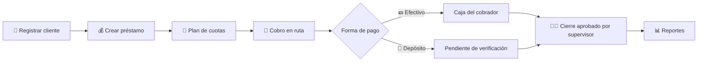
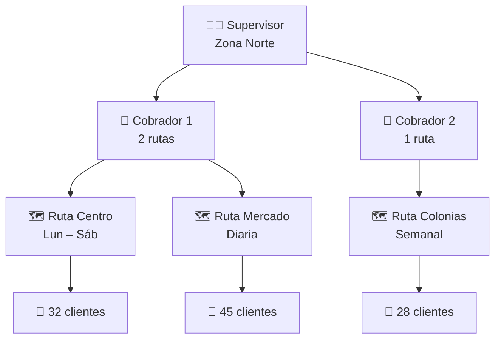

# 💰 PrestaControl

### Sistema de gestión de préstamos y cobranza

Controla tu cartera de préstamos de principio a fin: cuotas, intereses, mora, renovaciones, rutas de cobro, cobradores, supervisores y reportes en tiempo real.

Disponible en **alquiler mensual (SaaS)** o **compra de licencia**.

[Módulos](#-módulos) · [Cobranza en campo](#-cobranza-en-campo) · [Reportes](#-reportes) · [Planes](#-planes) · [Preguntas](#-preguntas-frecuentes) · [Contacto](#-contacto)

---

## ✨ Características destacadas

| | |
|---|---|
| **100 %** | Cálculo automático de cuotas |
| **24/7** | Acceso desde la nube |
| **+10** | Reportes listos para usar |
| **📍 GPS** | Ubicación capturada en cada pago |

### Vista previa del panel (ejemplo)

| Indicador | Valor | Tendencia |
|---|---:|:---:|
| Cartera activa | $248,350 | ▲ 8.2 % |
| Cobrado hoy | $12,480 | ▲ 3.1 % |
| En mora | 6.4 % | ▼ 1.2 % |

| Cliente | Ruta | Atraso | Estado |
|---|---|---:|:---:|
| Cliente A | Centro | 0 días | 🟢 Al día |
| Cliente B | Mercado | 3 días | 🟡 Gracia |
| Cliente C | Colonias | 17 días | 🔴 En mora |

---

## 🧩 Módulos

Cada módulo está integrado con los demás: un pago actualiza la cuenta corriente, la mora y los reportes al instante.

### 👤 Clientes
Expediente completo de cada cliente.
- ✅ Datos personales y documentos
- ✅ Referencias y garantías
- ✅ Historial crediticio interno

### 🗺️ Rutas y clientes por ruta
Organiza tu cartera por zonas de cobro.
- ✅ Clientes agrupados por ruta
- ✅ Orden de visita dentro de la ruta
- ✅ Dirección y coordenadas GPS del cliente
- ✅ Traslado de clientes entre rutas

### 🚶 Cobradores
Cada cobrador ve solo su trabajo del día.
- ✅ Rutas asignadas a cada cobrador
- ✅ Lista de cobro diaria por ruta
- ✅ Meta de recaudación y efectividad
- ✅ Cierre y cuadre de caja diario

### 🧑‍💼 Supervisores de cobro
Control del equipo en campo.
- ✅ Cobradores a cargo de cada supervisor
- ✅ Monitoreo de cobros en tiempo real
- ✅ Mapa de pagos registrados
- ✅ Aprobación de cierres de caja

### 💳 Formas de pago
Registra cómo paga cada cliente.
- ✅ Efectivo cobrado en ruta
- ✅ Depósito o transferencia bancaria
- ✅ Número de boleta y foto del comprobante
- ✅ Verificación de depósitos

### 📍 Pago con geolocalización
Cada cobro queda ubicado en el mapa.
- ✅ Captura automática de GPS al registrar el pago
- ✅ Fecha, hora y cobrador del registro
- ✅ Distancia al domicilio del cliente
- ✅ Alerta de pagos fuera de zona

### 💰 Préstamos
Configura cada préstamo a tu medida.
- ✅ Monto, tasa y plazo
- ✅ Frecuencia diaria, semanal, quincenal o mensual
- ✅ Interés fijo o sobre saldo

### 📅 Plan de cuotas
Tabla de amortización automática.
- ✅ Capital, interés y saldo por cuota
- ✅ Fechas de vencimiento
- ✅ Exclusión de domingos y feriados

### 🧾 Cuenta corriente y pagos
Cada movimiento queda registrado.
- ✅ Pagos parciales y adelantados
- ✅ Aplicación: mora → interés → capital
- ✅ Recibos y estado de cuenta
- ✅ Movimientos por forma de pago

### ⏰ Mora y días de atraso
Control automático de vencimientos.
- ✅ Cálculo diario de días de atraso
- ✅ Recargos configurables
- ✅ Días de gracia

### 🔄 Renovaciones
Renueva préstamos sin perder la trazabilidad.
- ✅ Liquidación del saldo anterior
- ✅ Cálculo de desembolso neto
- ✅ Historial de renovaciones vinculado

### 📊 Reportes
Información para tomar decisiones.
- ✅ Cartera activa y vencida
- ✅ Cobros por cobrador o ruta
- ✅ Exportación a PDF y Excel

### 🔐 Usuarios y seguridad
Acceso controlado por roles.
- ✅ Roles: Administrador, Supervisor, Cobrador, Consulta
- ✅ Autenticación segura (JWT)
- ✅ Bitácora de auditoría

---

## ⚙️ Cómo funciona

De la solicitud al cobro en 4 pasos:

1. **Registra al cliente**: captura sus datos y ubicación, y asígnalo a una ruta.
2. **Crea el préstamo**: define monto, tasa y frecuencia; el plan de cuotas se genera solo.
3. **Cobra en ruta**: el cobrador registra el pago en efectivo o depósito y el sistema guarda la ubicación GPS.
4. **Supervisa y analiza**: el supervisor valida cierres de caja, revisa el mapa de cobros y los reportes de mora.

---

## 🚶 Cobranza en campo

Tu equipo de cobro organizado y bajo control: supervisores a cargo de cobradores, cobradores con rutas asignadas y clientes agrupados por ruta. Cada pago queda registrado con su forma de pago y ubicación.

### Estructura de cobranza

### Registro de pago desde el celular del cobrador (ejemplo)

| Campo | Valor |
|---|---|
| Ruta / Cobrador | Ruta Mercado · Cobrador 2 |
| Cliente | Cliente B |
| Cuota | 8 de 20 |
| Atraso | 3 días |
| Monto | $ 150.00 |
| Forma de pago | **💵 Efectivo** / 🏦 Depósito |
| 📍 Ubicación capturada | 14.6349, -90.5069 · precisión 8 m |
| Distancia al domicilio | 35 m |

| Función | Descripción |
|---|---|
| 💵 **Pago en efectivo** | El cobrador lo recibe en ruta, se suma a su caja del día y se cuadra en el cierre. |
| 🏦 **Pago por depósito** | Se registra el banco, el número de boleta y la foto del comprobante; queda pendiente hasta que se verifica. |
| 📍 **Ubicación obligatoria** | Al confirmar el pago se guardan las coordenadas, la precisión, la fecha y la hora del registro. |
| 🚨 **Alertas de control** | El supervisor recibe aviso si un pago se registra lejos del domicilio o fuera de la ruta. |

---

## 📊 Reportes

Conoce el estado real de tu cartera con reportes filtrables por fecha, ruta, cobrador o cliente.

### Antigüedad de cartera (ejemplo)

| Rango | Porcentaje | |
|---|---:|---|
| 🟢 Al día | 78 % | `████████████████░░░░` |
| 🟡 1–30 días | 12 % | `██░░░░░░░░░░░░░░░░░░` |
| 🟠 31–60 días | 6 % | `█░░░░░░░░░░░░░░░░░░░` |
| 🔶 61–90 días | 3 % | `▌░░░░░░░░░░░░░░░░░░░` |
| 🔴 +90 días | 1 % | `▏░░░░░░░░░░░░░░░░░░░` |

### Reportes disponibles

| Reporte | Descripción |
|---|---|
| 📈 **Cartera activa** | Capital prestado, saldo pendiente e intereses por cobrar. |
| ⚠️ **Cartera vencida** | Clientes en mora agrupados por rangos de días de atraso. |
| 🚶 **Cobros del día** | Recaudación por cobrador, ruta y supervisor, con cuadre de caja. |
| 💳 **Cobros por forma de pago** | Efectivo y depósitos, incluidos los depósitos pendientes de verificar. |
| 🗺️ **Mapa de pagos** | Ubicación de cada pago registrado y alertas de pagos fuera de zona. |
| 🏅 **Desempeño de cobradores** | Efectividad de cobro, metas alcanzadas y mora por cartera asignada. |
| 📄 **Estado de cuenta** | Detalle de movimientos y saldo de cada cliente. |
| 💵 **Intereses ganados** | Rentabilidad por período, ruta o tipo de préstamo. |

---

## 💲 Planes

Alquílalo o cómpralo, tú eliges. Empieza con una suscripción mensual sin inversión inicial, o adquiere la licencia y el sistema es tuyo.

### Alquiler (SaaS)

| | Básico | ⭐ Profesional | Empresarial |
|---|:---:|:---:|:---:|
| **Precio** | **$29 / mes** | **$69 / mes** | **$149 / mes** |
| Ideal para | Prestamistas que inician | Negocios con equipo de cobro | Financieras en crecimiento |
| Préstamos activos | Hasta 150 | Hasta 1,000 | Ilimitados |
| Usuarios | 2 | 10 | Ilimitados |
| Clientes, préstamos y cuotas | ✅ | ✅ | ✅ |
| Control de mora | ✅ | ✅ | ✅ |
| Pagos en efectivo y depósito | ✅ | ✅ | ✅ |
| Rutas y cobradores | 1 ruta / 1 cobrador | ✅ | ✅ |
| Supervisores | — | ✅ | ✅ |
| Pagos con geolocalización | — | ✅ | ✅ |
| Verificación de depósitos | — | ✅ | ✅ |
| Renovaciones | — | ✅ | ✅ |
| Reportes PDF y Excel | Básicos | ✅ | ✅ |
| Mapa de pagos y alertas fuera de zona | — | — | ✅ |
| Múltiples sucursales | — | — | ✅ |
| API para integraciones | — | — | ✅ |
| Respaldos diarios | — | — | ✅ |
| Soporte | — | Chat | Prioritario + capacitación |

### Venta (licencia)

| | Licencia Estándar | ⭐ Licencia Plus | Código Fuente |
|---|:---:|:---:|:---:|
| **Precio** | **$1,200 pago único** | **$2,500 pago único** | **A cotizar** |
| Descripción | Instalación en tu propio servidor | Personalizado con tu marca | Propiedad total del sistema |
| Todos los módulos | ✅ | ✅ | ✅ |
| Usuarios ilimitados | ✅ | ✅ | ✅ |
| Instalación incluida | ✅ | ✅ | ✅ |
| Logo y colores de tu empresa | — | ✅ | ✅ |
| Ajustes a tus reglas de negocio | — | ✅ | ✅ |
| Capacitación del personal | — | ✅ | ✅ |
| Soporte | 3 meses | 12 meses | Implementación |
| Actualizaciones | 6 meses | 12 meses | — |
| Código fuente (.NET 10) y documentación técnica | — | — | ✅ |
| Derecho de modificación | — | — | ✅ |

> Precios de referencia en USD. No incluyen impuestos. Mantenimiento anual opcional para licencias.

### ¿Alquiler o venta?

| Característica | Alquiler (SaaS) | Venta (licencia) |
|---|---|---|
| Inversión inicial | Baja, pago mensual | Pago único |
| Servidor | Incluido en la nube | Propio o en tu nube |
| Actualizaciones | Automáticas e incluidas | Según el período contratado |
| Respaldos | Incluidos | A cargo del cliente |
| Personalización | Configuración estándar | Amplia |
| Ideal para | Empezar rápido | Control total de la información |

---

## ❓ Preguntas frecuentes

<b>¿Puedo configurar mis propias tasas de interés?</b>

Sí. Cada préstamo puede tener su propia tasa, plazo y frecuencia de pago, con interés fijo o calculado sobre saldo.

<b>¿Cómo se calculan los días de atraso y la mora?</b>

El sistema revisa los vencimientos todos los días, calcula los días de atraso de cada cuota y aplica el recargo que configures, respetando los días de gracia.

<b>¿Los cobradores pueden usarlo desde el celular?</b>

Sí. La plataforma es accesible desde cualquier navegador y cada cobrador ve únicamente los clientes de sus rutas asignadas.

<b>¿Cómo se toma la ubicación al registrar un pago?</b>

Al confirmar el pago, el celular del cobrador envía las coordenadas GPS, la precisión y la hora. El cobrador debe autorizar el acceso a la ubicación en su dispositivo.

<b>¿Qué controla el supervisor de cobro?</b>

Ve los cobros de sus cobradores en tiempo real, revisa el mapa de pagos, aprueba los cierres de caja y recibe alertas de pagos registrados fuera de zona.

<b>¿Cómo se manejan los pagos por depósito?</b>

El cobrador o el cliente reportan el depósito con banco, número de boleta y foto del comprobante. El pago queda pendiente hasta que un supervisor o administrador lo verifica.

<b>¿Qué pasa con mi información si dejo de pagar el alquiler?</b>

Puedes solicitar la exportación completa de tus datos en Excel antes de finalizar el servicio.

<b>¿Puedo pasar de alquiler a compra?</b>

Sí. Parte de lo pagado en suscripción puede abonarse a la compra de la licencia según las condiciones vigentes.

<b>¿Hay periodo de prueba?</b>

Ofrecemos una demostración guiada y un periodo de prueba para que evalúes el sistema con tus propios datos.

---

## 📬 Contacto

¿Quieres una demostración? Escríbenos y te mostramos cómo PrestaControl puede ordenar tu cartera de préstamos.

| Canal | Dato |
|---|---|
| 📧 Correo | [ventas@tuempresa.com](mailto:ventas@tuempresa.com) |
| 📱 Teléfono | +000 0000 0000 |
| 💬 WhatsApp | [Enviar mensaje](https://wa.me/000000000000) |

Cuéntanos cuántos préstamos manejas, cuántos cobradores tienes y qué plan te interesa.

---

## 🛠️ Tecnología

| Capa | Tecnología |
|---|---|
| Backend | ASP.NET Core 10 Web API |
| Arquitectura | Clean Architecture (Domain, Application, Infrastructure, Api) |
| Base de datos | EF Core 10 + SQL Server / PostgreSQL |
| Seguridad | JWT con roles (Administrador, Supervisor, Cobrador, Consulta) |
| Documentación API | OpenAPI / Scalar |
| Reportes | PDF (QuestPDF) y Excel (ClosedXML) |

La página de presentación completa está en [`landing/index.html`](landing/index.html).

---

© 2026 PrestaControl. Todos los derechos reservados.

